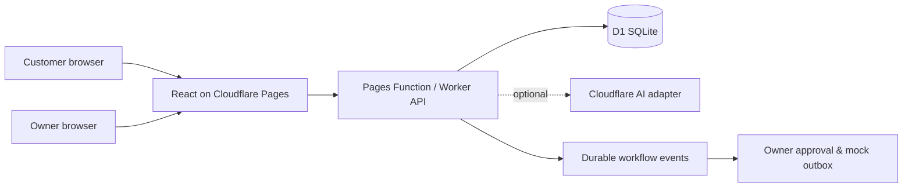

# MicroBizFlow AI

**Intelligent Customer Management and Business Automation for Small Businesses.**

MicroBizFlow AI is an open-source booking and customer workflow application for small service businesses. Its first example is **Harbour Cut Studio**, a fictional two-chair barbershop in Sri Lanka. Business hours, time zone, services, and resources are stored as data so the booking logic can support other appointment-based businesses.

## Current status

The public demo is live at **[microbizflow-ai.pages.dev](https://microbizflow-ai.pages.dev/)**. It uses fictional seed data and accepts booking contacts ending in `@example.invalid` only. The customer page now presents a salon-focused visual, service details, a booking assistant, and a clear AI and automation walkthrough. The standalone Worker has an hourly Cron Trigger for the bounded demo reset; production CPU usage still needs observation.

Visitors can explore the owner workspace preview at `/owner-preview` without signing in. It uses four fictional records held only in the browser; the real owner dashboard and customer records remain protected. In local development, open `http://127.0.0.1:8788/owner-preview`.

See the [deployment record](docs/deployment.md) for the verified release, free-tier limits, and remaining monitoring checks.

The application includes service browsing, real slot availability, pending booking requests, database-enforced chair capacity, idempotent submissions, reference-and-code status lookup and cancellation, owner sign-in, appointment decisions, searchable and exportable owner appointments, business-profile, service, and working-hours management, searchable customer records with private notes and owner-controlled deletion, owner analytics from stored records, a no-key English/Sinhala enquiry assistant with a structured owner review queue, approval-gated mock notifications and appointment reminder drafts, signed inbound webhook support, and a durable mock CRM sync. The live demo uses a fixed fictional visitor name, discards booking notes, and sends no real messages. Remote AI inference and inbound webhooks are optional and unconfigured in production. Real messaging and external CRM providers are still on the [roadmap](docs/roadmap.md). Do not use the public demo for real customer data.

## AI and automation in the demo

The **no-key assistant** reads a visitor's English or Sinhala enquiry and suggests a service, date, and time when it recognizes them. Missing details stay missing. A visitor must still choose an available slot; the booking API and D1 capacity rules make the actual decision. Cloudflare Workers AI is an optional adapter and is **not enabled** in the public demo.

Booking events create durable owner activity and customer draft notifications. The owner reviews appointment requests and must approve customer drafts. Delivery is recorded in a **mock outbox**; the public demo sends no real email or SMS and does not connect to an external CRM. The [interactive owner workflow preview](https://microbizflow-ai.pages.dev/owner-preview) uses fictional records in browser memory and never loads private customer data.


[Customer page at mobile width](docs/screenshots/customer-mobile.png) · The studio image is generated and illustrative; Harbour Cut Studio is fictional.


[Full owner workspace preview](docs/screenshots/owner-preview.png) · [Mobile owner preview](docs/screenshots/owner-preview-mobile.png) · [Owner sign-in](docs/screenshots/owner-login.png). All screenshots use fictional demonstration data.

## Local setup

Requires Node.js 24+, npm, and Python 3.12+ for the SQL tests. Wrangler is installed through npm. No Cloudflare account or paid API is needed for local development.

```sh
npm ci
npm run db:migrate:local
npm run db:seed:local
npm run owner:setup:local
npm run build
npm run dev:pages
```

The owner setup command prompts for a password and writes a PBKDF2 hash to ignored `.dev.vars`. It never prints or stores the plaintext password. Choose a local password you can remember. Open `http://127.0.0.1:8788/` for booking and `/owner` for the protected owner view. The local username is `owner`. The seed business and all intended test records are fictional. Use synthetic contact details ending in `.invalid` when trying bookings.

For frontend hot reload, run `npm run dev:api` and `npm run dev:web` in separate terminals instead of `dev:pages`. The Vite page is at `http://127.0.0.1:5173/` and proxies `/api` to the local Worker at port 8787. `npm run build` refreshes the static Pages output. Wrangler's local D1 data lives under ignored `.wrangler/`.

## Checks

```sh
npm run typecheck
npm run lint
npm test
python -m unittest discover -s tests
npm run build
# With npm run dev:pages running in another terminal:
npm run test:e2e
npm run test:integration:local
npm run test:ai:local
# Set LOCAL_OWNER_PASSWORD first for the protected workflow test:
npm run test:workflow:local
npm run test:config:local
npm run test:customers:local
npm run test:analytics:local
npm run test:cancellation:local
npm run test:webhook:local
npm run test:enquiries:local
npm run test:privacy:local
npm run test:retention:local
npm run test:security:local
npm run test:scheduled:local
npm run test:reminders:local
npm run test:crm:local
npm run test:demo:local
```

The Playwright suite creates a fictional browser booking and verifies owner routes require sign-in. It starts Pages if needed, uses installed Chrome on Windows, and runs in CI after local D1 migration and seed. On Linux, install Chromium with `npx playwright install chromium`. The integration smoke test creates fictional bookings in the local D1 database. It checks that simultaneous requests fill two chairs, a third conflicts, and an idempotent replay returns the same reference. [Testing notes](docs/testing.md) record the current results and limits.

The assistant smoke test checks English and Sinhala suggestions without a model key. The [AI evaluation](docs/ai-evaluation.md) describes supported cases and limits. A configured Cloudflare Workers AI binding can use JSON mode only after the visitor explicitly opts in; malformed output, timeouts, and quota errors fall back to deterministic extraction. The UI requires a customer to pick a real available slot before submitting.

The protected workflow smoke test needs `LOCAL_OWNER_PASSWORD` set in that terminal; it never prints it. It creates a fictional booking, confirms it through the owner API, approves the resulting customer draft, and verifies mock delivery without sending a real message. See [automation behavior](docs/automation.md).

## Architecture

React, TypeScript, Vite, and Tailwind CSS power the web UI. A TypeScript Cloudflare Worker handles REST routes with Zod validation. The same handler runs as a Cloudflare Pages Function, keeping the web app and session cookie on one origin. Cloudflare D1 stores the configuration, appointments, owner sessions, and audit records. The database rejects overlapping reservations on a resource. Optional AI can suggest fields, while booking rules remain deterministic. External integrations are planned.



See [architecture decisions](docs/architecture.md), [integration boundary](docs/integrations.md), [deployment prerequisites](docs/deployment.md), the [Cloudflare Free deployment plan](docs/deployment-plan.md), and [privacy notes](PRIVACY.md).

## API snapshot

- `GET /api/business` — public business information, services, and hours
- `GET /api/availability?serviceId=...&date=YYYY-MM-DD` — available 15-minute starts
- `POST /api/bookings` — pending booking request with an idempotency UUID
- `POST /api/bookings/status` and `/api/bookings/cancel` — private-code lookup and cancellation
- `POST /api/enquiries/analyze` — structured suggestion, no-key by default
- `GET /api/owner/enquiries` — private structured analysis review queue; no raw message text stored
- `/api/owner/*` — login, session, logout, private appointments, filters, CSV export, summary, and state changes
- `/api/owner/customers*` — protected customer search, appointment history, and private notes
- `GET /api/owner/analytics` — protected booking and workflow metrics calculated from stored records
- `POST /api/webhooks/inbound` — optional HMAC-signed follow-up events; disabled without a server secret

Owner sessions use HTTP-only cookies. Public booking requests and login attempts have database-backed limits. The interface shows pending requests accurately; it does not send customer messages.

## Project documents

- [Roadmap and progress](docs/roadmap.md) · [Progress log](docs/progress.md)
- [Architecture](docs/architecture.md) · [Automation](docs/automation.md) · [Testing](docs/testing.md) · [Deployment](docs/deployment.md)
- [Security](SECURITY.md) · [Privacy](PRIVACY.md) · [Contributing](CONTRIBUTING.md) · [Code of Conduct](CODE_OF_CONDUCT.md)

## License

Original project code is released under the [MIT License](LICENSE). Third-party packages retain their own licenses.
