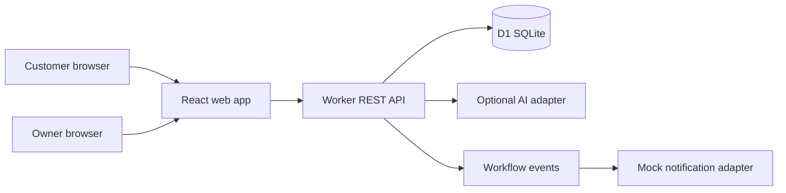

# MicroBizFlow AI

**Intelligent Customer Management and Business Automation for Small Businesses.**

MicroBizFlow AI is an open-source appointment and customer workflow application for small service businesses. The first example business is a fictional two-chair barbershop in Sri Lanka. The shared booking model is intended to support other appointment-based businesses.

## Current status

Project foundation is in progress. No public demo or working application is claimed yet. See [progress](docs/progress.md) and [roadmap](docs/roadmap.md) for implemented work and remaining milestones.

## Intended workflows

- Customers browse services, check real availability, and request an appointment.
- Owners use a protected dashboard to manage bookings, services, customers, and working hours.
- Optional AI extracts structured intent from English and Sinhala enquiries. Deterministic rules control all booking decisions, and a no-key mode keeps core flows usable.
- Workflow events, approval gates, and mock notifications support safe automation without sending messages to real people from the demo.

## Architecture

The planned system uses React, TypeScript, Vite, and Tailwind CSS for the web app; a TypeScript Cloudflare Worker with Zod-validated REST endpoints; and Cloudflare D1 with SQL migrations. [Architecture decisions](docs/architecture.md) describe data boundaries and booking concurrency.

## Development and deployment

The runnable setup instructions, environment variables, migration commands, and screenshots will be added when those components exist. Do not deploy this foundation as a functional product. See [deployment](docs/deployment.md) and [testing](docs/testing.md) for current prerequisites and verification status.

## Project documents

- [Architecture](docs/architecture.md)
- [Roadmap](docs/roadmap.md)
- [Progress](docs/progress.md)
- [Testing](docs/testing.md)
- [Deployment](docs/deployment.md)
- [Security policy](SECURITY.md)
- [Privacy notes](PRIVACY.md)
- [Contributing](CONTRIBUTING.md)

## License

Original project code is released under the [MIT License](LICENSE). Third-party packages retain their own licenses; review dependencies before publishing builds.
