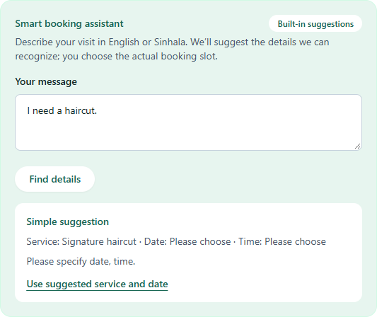
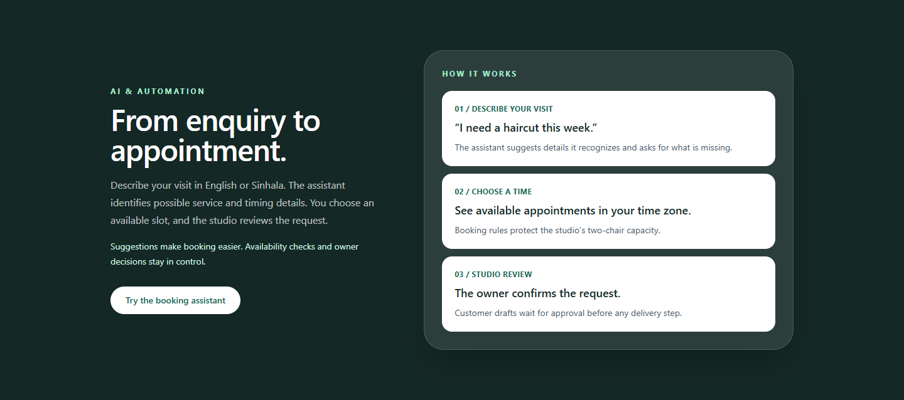
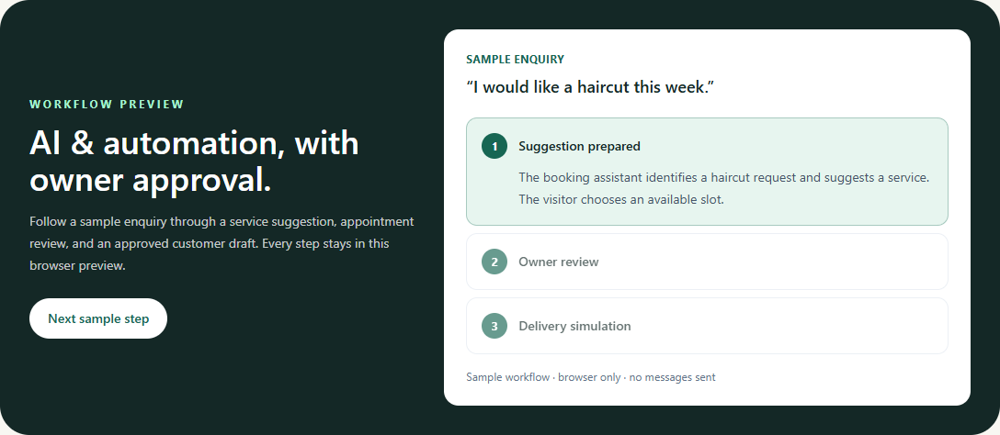
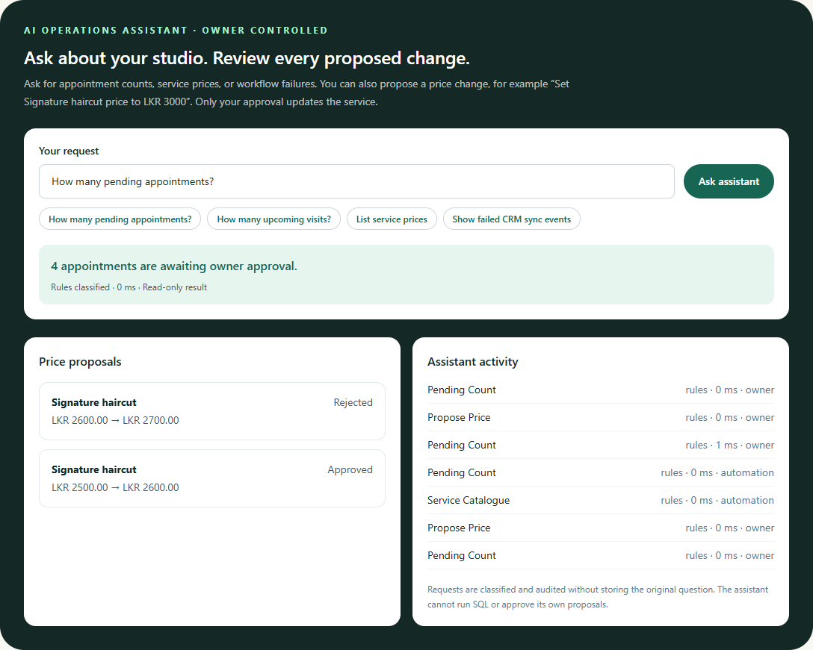
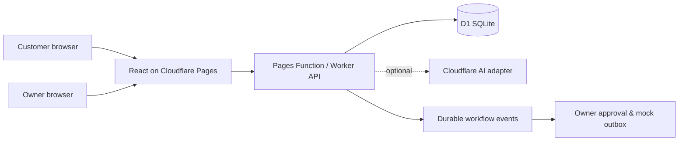

# MicroBizFlow AI

**Booking, customer operations, and AI-assisted workflows for appointment-based businesses.**

MicroBizFlow AI is a deployed React and TypeScript application backed by a Cloudflare Worker API and D1. The showcase follows **Harbour Cut Studio**, a two-chair Colombo salon, from a customer's first enquiry through booking, owner review, and follow-up activity. Business hours, time zone, services, and resources are data-driven so the same booking engine can support other appointment-based businesses.

**[Live booking app](https://microbizflow-ai.pages.dev/) · [Interactive owner preview](https://microbizflow-ai.pages.dev/owner-preview) · [Architecture](docs/architecture.md) · [Verified deployment](docs/deployment.md)**

> **Portfolio demo:** Harbour Cut Studio and its records are fictional; the studio image was generated for this showcase. Booking accepts only `@example.invalid` contacts. Notifications and CRM delivery are simulated, and no real customer messages are sent.

## Engineering highlights

| Area | Implemented and verified |
| --- | --- |
| Booking correctness | Configurable services and hours, business time zone, real slot availability, D1-enforced two-chair capacity, idempotent requests, private-code status lookup and cancellation |
| Owner operations | Protected sessions and business-scoped routes for appointment decisions, service settings, customer records, CSV export, and analytics |
| AI assistance | English and Sinhala enquiry suggestions, configurable LLM adapters with validated output and deterministic fallback, plus a booking API that checks every suggested slot |
| Workflow automation | Five version-controlled n8n Community workflows with hosted Worker equivalents: lead intake, owner-approved booking, reminders and follow-ups, CRM sync, and permission-controlled owner queries |
| Delivery | Cloudflare Pages, Workers, and D1 on Free services; TypeScript, lint, unit and schema tests, browser CI, and live HTTPS smoke checks |

The authenticated owner workspace includes an enquiry review queue, private customer notes and deletion, workflow activity, mock CRM sync, and an operations assistant that requires approval before changing a service price. The public owner preview uses sample records held only in browser memory. **The live site currently runs an earlier release; the five-workflow implementation is tested on `deploymentBranch` and awaits the production migration and deployment review.** See the [local n8n guide](docs/n8n.md), [automation design](docs/automation.md), and [progress record](docs/progress.md).

## Assistant and automation

The live assistant extracts possible service and timing details from English or Sinhala enquiries without an external model. An optional Workers AI adapter is implemented but **not enabled** in this deployment. Suggestions never book an appointment: the visitor selects a real slot, and the API applies working-hours, timing, and capacity rules. Missing details remain open for the visitor to choose.

Booking events create durable owner activity and customer drafts. The owner reviews requests and approves drafts before the mock delivery step. The [interactive workflow preview](https://microbizflow-ai.pages.dev/owner-preview) lets visitors inspect this sequence without signing in.

### Five executable workflows on `deploymentBranch`

| Workflow | Hosted Worker behavior | Local n8n demonstration |
| --- | --- | --- |
| Lead qualification | Consent-gated lead and customer record, validated optional LLM classification, idempotency | Import `01-lead-qualification.json` and post a fictional enquiry |
| Appointment approval | Live availability and D1 capacity check; owner confirms a pending request | Import `02-appointment-request.json` and submit an available slot |
| Reminders and follow-ups | Hourly Cron queues drafts; owner approval precedes mock delivery | Import `03-reminders-followups.json` and call the local tick |
| CRM synchronization | Durable event keys, retry backoff, dead-letter queue; optional non-demo HubSpot adapter | Import `04-crm-sync.json` and process due events |
| Owner operations assistant | Fixed read-only business queries; explicit price proposals need owner approval | Import `05-owner-operations-assistant.json` and ask a scoped question |

All five workflows have importable JSON, local execution checks, and Worker tests. The public demo has no model key or real CRM credential, so model calls and HubSpot delivery remain unverified. It sends no real customer messages. [Setup and observed results](docs/n8n.md) · [CRM boundary](docs/integrations.md).

## Product preview


[Mobile customer view](docs/screenshots/customer-mobile.png)









[Full owner workspace](docs/screenshots/owner-preview.png) · [Mobile owner view](docs/screenshots/owner-preview-mobile.png) · [Owner sign-in](docs/screenshots/owner-login.png). Screenshots use sample data.

## Local setup

Requires Node.js 24+, npm, and Python 3.12+ for the SQL tests. Wrangler is installed through npm. No Cloudflare account or paid API is needed for local development.

```sh
npm ci
npm run db:migrate:local
npm run db:seed:local
npm run owner:setup:local
npm run build
npm run dev:pages
```

The owner setup command prompts for a password and writes a PBKDF2 hash to ignored `.dev.vars`. It never prints or stores the plaintext password. Choose a local password you can remember. Open `http://127.0.0.1:8788/` for booking and `/owner` for the protected owner view. The local username is `owner`. The seed business and all intended test records are fictional. Use synthetic contact details ending in `.invalid` when trying bookings.

For frontend hot reload, run `npm run dev:api` and `npm run dev:web` in separate terminals instead of `dev:pages`. The Vite page is at `http://127.0.0.1:5173/` and proxies `/api` to the local Worker at port 8787. `npm run build` refreshes the static Pages output. Wrangler's local D1 data lives under ignored `.wrangler/`.

## Checks

```sh
npm run typecheck
npm run lint
npm test
python -m unittest discover -s tests
npm run build
# With npm run dev:pages running in another terminal:
npm run test:e2e
npm run test:integration:local
npm run test:ai:local
# Set LOCAL_OWNER_PASSWORD first for the protected workflow test:
npm run test:workflow:local
npm run test:config:local
npm run test:customers:local
npm run test:analytics:local
npm run test:cancellation:local
npm run test:webhook:local
npm run test:enquiries:local
npm run test:privacy:local
npm run test:retention:local
npm run test:security:local
npm run test:scheduled:local
npm run test:reminders:local
npm run test:crm:local
npm run test:operations:local
npm run test:n8n
npm run test:demo:local
```

The Playwright suite creates a fictional browser booking and verifies owner routes require sign-in. It starts Pages if needed, uses installed Chrome on Windows, and runs in CI after local D1 migration and seed. On Linux, install Chromium with `npx playwright install chromium`. The integration smoke test creates fictional bookings in the local D1 database. It checks that simultaneous requests fill two chairs, a third conflicts, and an idempotent replay returns the same reference. [Testing notes](docs/testing.md) record the current results and limits.

The assistant smoke test checks English and Sinhala suggestions without a model key. The [AI evaluation](docs/ai-evaluation.md) describes supported cases and limits. A configured Cloudflare Workers AI binding can use JSON mode only after the visitor explicitly opts in; malformed output, timeouts, and quota errors fall back to deterministic extraction. The UI requires a customer to pick a real available slot before submitting.

The protected workflow smoke test needs `LOCAL_OWNER_PASSWORD` set in that terminal; it never prints it. It creates a fictional booking, confirms it through the owner API, approves the resulting customer draft, and verifies mock delivery without sending a real message. See [automation behavior](docs/automation.md).

## Architecture

React, TypeScript, Vite, and Tailwind CSS power the web UI. A TypeScript Cloudflare Worker handles REST routes with Zod validation. The same handler runs as a Cloudflare Pages Function, keeping the web app and session cookie on one origin. Cloudflare D1 stores configuration, appointments, owner sessions, workflow histories, and audit records. The database rejects overlapping reservations on a resource. Optional AI can suggest fields and classify owner questions; booking and approval rules remain deterministic. The HubSpot adapter needs a scoped development credential before its first live test.



See [architecture decisions](docs/architecture.md), [integration boundary](docs/integrations.md), [deployment prerequisites](docs/deployment.md), the [Cloudflare Free deployment plan](docs/deployment-plan.md), and [privacy notes](PRIVACY.md).

## API snapshot

- `GET /api/business` — public business information, services, and hours
- `GET /api/availability?serviceId=...&date=YYYY-MM-DD` — available 15-minute starts
- `POST /api/bookings` — pending booking request with an idempotency UUID
- `POST /api/bookings/status` and `/api/bookings/cancel` — private-code lookup and cancellation
- `POST /api/enquiries/analyze` — structured suggestion, no-key by default
- `GET /api/owner/enquiries` — private structured analysis review queue; no raw message text stored
- `/api/owner/*` — login, session, logout, private appointments, filters, CSV export, summary, and state changes
- `/api/owner/customers*` — protected customer search, appointment history, and private notes
- `GET /api/owner/analytics` — protected booking and workflow metrics calculated from stored records
- `POST /api/webhooks/inbound` — optional HMAC-signed follow-up events; disabled without a server secret

Owner sessions use HTTP-only cookies. Public booking requests and login attempts have database-backed limits. The interface shows pending requests accurately; it does not send customer messages.

## Project documents

The [five-workflow production release plan](docs/automation-deployment-plan.md) lists the exact migration, Free-tier, security, and verification steps awaiting approval.

- [Roadmap and progress](docs/roadmap.md) · [Progress log](docs/progress.md)
- [Architecture](docs/architecture.md) · [Automation](docs/automation.md) · [Testing](docs/testing.md) · [Deployment](docs/deployment.md)
- [Security](SECURITY.md) · [Privacy](PRIVACY.md) · [Contributing](CONTRIBUTING.md) · [Code of Conduct](CODE_OF_CONDUCT.md)

## License

Original project code is released under the [MIT License](LICENSE). Third-party packages retain their own licenses.
