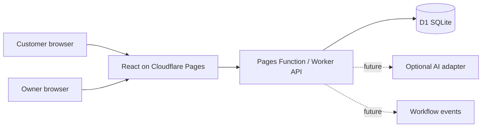

# MicroBizFlow AI

**Intelligent Customer Management and Business Automation for Small Businesses.**

MicroBizFlow AI is an open-source booking and customer workflow application for small service businesses. Its first example is **Harbour Cut Studio**, a fictional two-chair barbershop in Sri Lanka. Business hours, time zone, services, and resources are stored as data so the booking logic can support other appointment-based businesses.

## Current status

A working **local MVP** includes service browsing, real slot availability, pending booking requests, database-enforced chair capacity, idempotent submissions, owner sign-in, appointment decisions, and a small owner summary. The public repository exists, but **no public demo has been deployed**. AI extraction, notifications, CRM integrations, customer cancellation, and several owner settings are still on the [roadmap](docs/roadmap.md). Do not use the current build for real customer data.


[Narrow viewport preview](docs/screenshots/customer-mobile.png) · Screenshots show fictional demonstration data.

## Local setup

Requires Node.js 24+, npm, and Python 3.12+ for the SQL tests. Wrangler is installed through npm. No Cloudflare account or paid API is needed for local development.

```sh
npm ci
npm run db:migrate:local
npm run db:seed:local
npm run owner:setup:local
npm run build
npm run dev:pages
```

The owner setup command prompts for a password and writes a PBKDF2 hash to ignored `.dev.vars`. It never prints or stores the plaintext password. Choose a local password you can remember. Open `http://127.0.0.1:8788/` for booking and `/owner` for the protected owner view. The local username is `owner`. The seed business and all intended test records are fictional. Use synthetic contact details ending in `.invalid` when trying bookings.

For frontend hot reload, run `npm run dev:api` and `npm run dev:web` in separate terminals instead of `dev:pages`. The Vite page is at `http://127.0.0.1:5173/` and proxies `/api` to the local Worker at port 8787. `npm run build` refreshes the static Pages output. Wrangler's local D1 data lives under ignored `.wrangler/`.

## Checks

```sh
npm run typecheck
npm run lint
npm test
python -m unittest discover -s tests
npm run build
# With npm run dev:pages running in another terminal:
npm run test:integration:local
```

The integration smoke test creates fictional bookings in the local D1 database. It checks that simultaneous requests fill two chairs, a third conflicts, and an idempotent replay returns the same reference. [Testing notes](docs/testing.md) record the current results and limits.

## Architecture

React, TypeScript, Vite, and Tailwind CSS power the web UI. A TypeScript Cloudflare Worker handles REST routes with Zod validation. The same handler runs as a Cloudflare Pages Function, keeping the web app and session cookie on one origin. Cloudflare D1 stores the configuration, appointments, owner sessions, and audit records. The database rejects overlapping reservations on a resource. AI and external integrations are planned as optional adapters; booking rules do not depend on AI.



See [architecture decisions](docs/architecture.md), [deployment prerequisites](docs/deployment.md), and [privacy notes](PRIVACY.md).

## API snapshot

- `GET /api/business` — public business information, services, and hours
- `GET /api/availability?serviceId=...&date=YYYY-MM-DD` — available 15-minute starts
- `POST /api/bookings` — pending booking request with an idempotency UUID
- `/api/owner/*` — login, session, logout, private appointments, summary, and state changes

Owner sessions use HTTP-only cookies. Public booking requests and login attempts have database-backed limits. The interface shows pending requests accurately; it does not send customer messages.

## Project documents

- [Roadmap and progress](docs/roadmap.md) · [Progress log](docs/progress.md)
- [Architecture](docs/architecture.md) · [Testing](docs/testing.md) · [Deployment](docs/deployment.md)
- [Security](SECURITY.md) · [Privacy](PRIVACY.md) · [Contributing](CONTRIBUTING.md) · [Code of Conduct](CODE_OF_CONDUCT.md)

## License

Original project code is released under the [MIT License](LICENSE). Third-party packages retain their own licenses.
