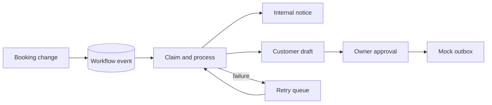

# Workflow and notification behavior

The appointment database triggers enqueue a durable workflow event when a booking is created or its status changes. The API tries to process the new event immediately. If that step fails, the event remains available for owner-triggered retry in the dashboard. Event keys are unique, processing claims have a 60-second lease, and each event has at most three attempts. Notification event keys are also unique, so replaying an event does not create duplicate drafts.

New booking requests create an internal notice. Confirmed, declined, and cancelled bookings create customer-facing drafts that **cannot** enter the mock outbox until the owner approves them. The mock adapter records delivery locally and sends no external email, SMS, or message. A failed mock delivery can be retried after approval. State changes are audited in `notification_audit`; appointment changes are audited separately.

The owner dashboard shows the latest 50 workflow events and notifications, approval actions, failures, and a “Process pending events” control. The event processor also runs after successful booking and status API calls. The queue is stored in D1 and does not require n8n or another continuously running service.

The current implementation does not include external webhooks, reminders, real messaging providers, customer notification retrieval, or n8n templates. Enabling any real outbound channel needs credentials, consent, and an explicit provider implementation with delivery idempotency. No real messages should be sent from a public demo.
