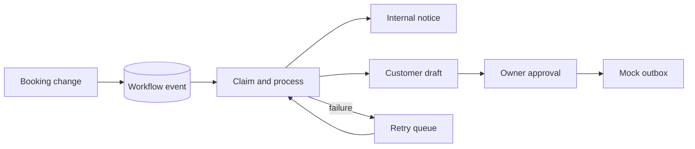

# Workflow and notification behavior

The appointment database triggers enqueue a durable workflow event when a booking is created or its status changes. The API tries to process the new event immediately. If that step fails, the event remains available for owner-triggered retry in the dashboard. Event keys are unique, processing claims have a 60-second lease, and each event has at most three attempts. Notification event keys are also unique, so replaying an event does not create duplicate drafts.

New booking requests create an internal notice. Confirmed, declined, and cancelled bookings create customer-facing drafts that **cannot** enter the mock outbox until the owner approves them. The mock adapter records delivery locally and sends no external email, SMS, or message. A failed mock delivery can be retried after approval. State changes are audited in `notification_audit`; appointment changes are audited separately.

The owner dashboard shows the latest 50 workflow events and notifications, approval actions, failures, and a “Process pending events” control. The event processor also runs after successful booking and status API calls. The queue is stored in D1 and does not require n8n or another continuously running service.

The standalone Worker has an hourly UTC Cron Trigger definition in `wrangler.worker.toml`. Its scheduled handler queues reminders and retries at most two workflow events and two inbound webhooks per invocation; existing attempt limits, leases, and unique keys still apply. This is checked-in configuration only. No Cloudflare Worker or Cron Trigger has been deployed. `npm run test:scheduled:local` exercises the handler with local Wrangler and deliberately failed fictional records. The Pages Function wrapper does not run this scheduled handler; production requires the separate Worker to share the approved D1 database. Free-plan CPU usage still needs a deployment-readiness review.

Confirmed appointments between one and 24 hours away can produce one idempotent reminder draft. The hourly handler queues these automatically when deployed; the owner can also prepare them manually. The current workflow table stores reminder events with the `reminder_due` subject marker. Reminder drafts require owner approval and use only the mock outbox. If a booking is cancelled or its start time passes, approval and retry are blocked. No real reminder is sent.

An optional inbound webhook accepts `POST /api/webhooks/inbound` only when the server-only `WEBHOOK_SECRET` is configured with at least 32 characters. The sender supplies `X-MicroBizFlow-Timestamp` as Unix seconds and `X-MicroBizFlow-Signature` as `sha256=` plus lowercase HMAC-SHA256 hex for `<timestamp>.<raw JSON body>`. The timestamp must be within five minutes. The JSON body is `{ "id": "<UUID>", "type": "booking.followup_requested", "reference": "MBF-1234ABCD" }`. A valid event creates a business-scoped owner follow-up task for an existing booking. Duplicate IDs return the prior state without another task; failed processing stays in D1 for owner-triggered retry, up to three attempts. The owner can mark a task done. The secret is never exposed to the browser or repository.

The webhook is disabled by default. The local `npm run test:webhook:local` script uses a synthetic secret and fictional booking. It verifies HMAC signing, freshness, deduplication, private activity, and task completion. This is an inbound mock integration; it does not call HubSpot, Google, or any messaging provider.

The current implementation does not include real messaging providers, customer notification retrieval, or n8n templates. Enabling any real outbound channel needs credentials, consent, and an explicit provider implementation with delivery idempotency. No real messages should be sent from a public demo.
